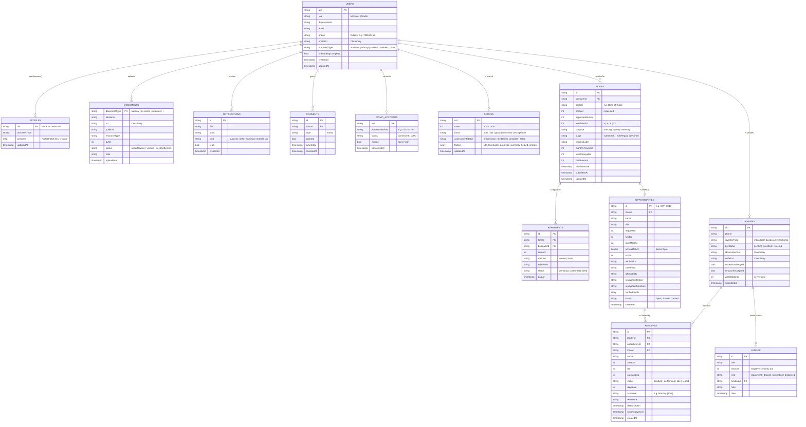

# Staki Fund - Firestore data model

Owner: Uche. Database: Cloud Firestore `(default)` in `africa-south1`,
project `staki-bc71f`. Files (IDs, statements, selfies) are stored on
**Cloudinary**; Firestore only keeps their HTTPS link.

Fields come from the models the screens already use
(`frontend/lib/presentation/features/*/providers/*_models.dart`), so swapping
a mock repository for a Firestore one should not change any UI.

## Conventions

- Money is an **integer in RWF** (no decimals), e.g. `500000`.
- Dates are Firestore **timestamps** (`createdAt`, `updatedAt`, ...).
- Enums are stored as the Dart enum **name** string, e.g. `underReview`,
  `veryGood`, `momo`. Use `MyEnum.values.byName(...)` to read them.
- A document that belongs to one user is keyed by that user's Firebase Auth
  `uid`, or stores it in `userId` / `borrowerId` / `lenderId`.
- "Server" below means the Admin SDK (Cloud Functions or the seed script).
  Server writes skip security rules.

## ERD

## Collections

| Path | What it holds | Client can | Server only |
| --- | --- | --- | --- |
| `users/{uid}` | Account basics and role | owner reads; creates/updates own (not `role` after creation) | - |
| `users/{uid}/documents/{documentType}` | Uploaded borrower documents | owner reads, deletes, submits with `status: underReview` | sets `verified` / `needsAttention` |
| `users/{uid}/notifications/{id}` | In-app notifications | owner reads, marks `read` | creates |
| `profiles/{uid}` | Borrower profile answers (Section 02) | owner reads and writes | - |
| `consents/{id}` | Consent ledger (audit trail) | owner reads, grants, revokes | never deleted |
| `momoAccounts/{uid}` | Connected MoMo wallet | owner reads | writes (`eligible` comes from scoring) |
| `scores/{uid}` | Credit Passport score and factors | owner reads | writes (scoring engine) |
| `loans/{loanId}` | Loan applications and lifecycle | borrower reads own, creates with `stage: submitted` | every stage change |
| `repayments/{id}` | Repayments against a loan | borrower reads own, creates with `status: pending` | confirms / fails |
| `opportunities/{id}` | Anonymised loans shown to lenders | any signed-in user reads | writes, updates `funded` |
| `lenders/{uid}` | Lender onboarding and KYC | owner reads, creates with `kycStatus: pending`, edits own details | `kycStatus`, `walletBalance` |
| `lenders/{uid}/ledger/{id}` | Wallet history | owner reads | writes |
| `fundings/{id}` | A lender's allocation to an opportunity | lender reads own, creates with `status: pending` | status, repayments |

## Fixed document types

`users/{uid}/documents/{documentType}` uses these IDs (see
`documentCatalog` in `firestore_document_repository.dart`):

| documentType | Title | Requirement |
| --- | --- | --- |
| `national_id` | National ID | mandatory |
| `momo_statement` | MTN MoMo Statement | mandatory |
| `business_registration` | Business Registration (RDB) | mandatory |
| `bank_statement` | Bank Statement | recommended |
| `proof_of_enrollment` | Proof of Enrollment | optional |

## Main queries (and their indexes)

| Screen | Query | Index |
| --- | --- | --- |
| My loans | `loans` where `borrowerId == uid` order by `submittedAt desc` | composite |
| Repayment history | `repayments` where `loanId == id` order by `paidAt desc` | composite |
| Marketplace | `opportunities` where `status == open` order by `createdAt desc` | composite |
| Marketplace (risk) | `opportunities` where `status == open` order by `score desc` | composite |
| Portfolio | `fundings` where `lenderId == uid` order by `createdAt desc` | composite |
| Consent history | `consents` where `userId == uid` order by `grantedAt desc` | composite |
| Unread badge | `users/{uid}/notifications` where `read == false` order by `createdAt desc` | composite |

All indexes live in `backend/firestore.indexes.json`.
